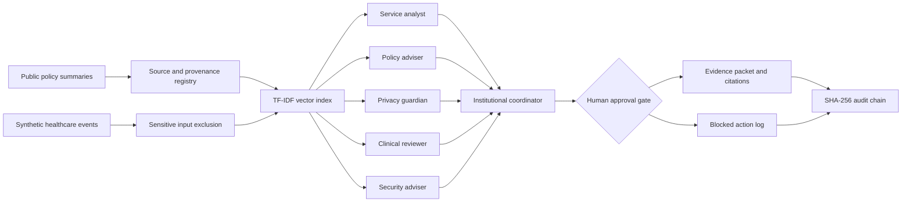

# Architecture and evidence flow

This is a self-contained, reproducible **proof of concept**, not a commissioned or deployed government platform.

## ITU-T Y.3172 logical mapping

| Node | Mapped prototype element | Readiness or governance consideration |
|---|---|---|
| SRC | Official source registry and synthetic events | Data provenance, lawful acquisition, accessibility |
| C | Read-only file-based collectors | Ownership, access controls, source freshness |
| PP | Restricted-data rejection, tokenization and TF-IDF | Data quality, preprocessing, multilingual plans |
| M | Service, policy, privacy, clinical and security agents | Agent evaluation, bias and uncertainty |
| P | Privacy/clinical rules and mandatory human approval | Oversight, legal basis, safe autonomy limits |
| D | Role-scoped results, citations, audit chain | Traceability and secure delivery |
| SINK | Decision-support interface for authorized human owners | Human interaction and inclusion |

**Important:** Y.3172 is a standard for ML architecture in future networks. Reuse here is a logical architectural analogy, not a claim of healthcare accreditation. The prototype does not implement a distributed, production ML orchestration infrastructure.

## Open-source scope

- Public source URLs with *short original summaries*. The actual legal texts are **not** bundled or scraped.
- Synthetic service data, synthetic issues, and reproducible agent outputs.
- No EHS credentials, internal documentation, patient information, APIs or actual deployment connections.

## Future validated pilot gaps

Vector database and document chunking, validated ingestion and source effective dates, full bilingual evaluations, government access controls, mandated cybersecurity controls, real human workflow approvals, privacy impact assessments, independent legal review, and approved healthcare-specific testing.
